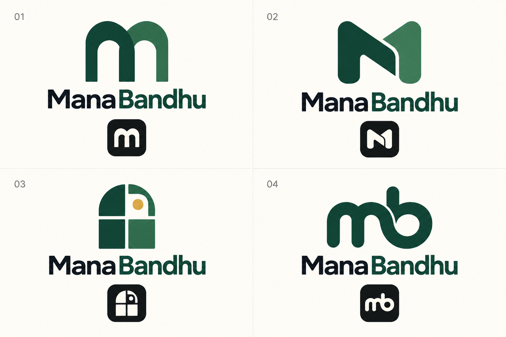

# ManaBandhu logo concepts

Four generated visual concepts for review; these have not replaced the app's current logo.

[Open the full-size logo sheet](manabandhu-logo-concepts.png).

1. Connected doorway arches: welcoming M monogram.
2. Interlocking M: compact connection symbol, recommended direction.
3. Neighborhood window: architectural mark with a small warm accent.
4. Rounded mb ligature: friendly typographic identity.

This is a raster concept sheet, not production vector artwork.
